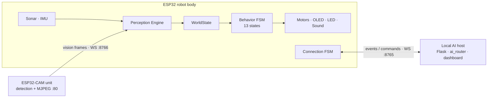
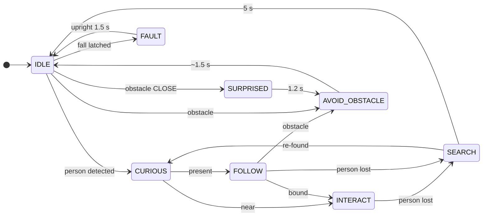
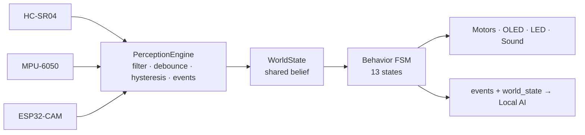

<div align="center">

# AI Pet Robot

**A desktop pet robot with a local personality, a perception stack and an LLM brain.**

It sees people, feels obstacles and knows when it has fallen over,<br>
and it keeps living even when the network goes away.

<br>


[Quick start](#quick-start) &nbsp;·&nbsp;
[Architecture](#architecture) &nbsp;·&nbsp;
[Hardware](#hardware) &nbsp;·&nbsp;
[Protocol](#protocol) &nbsp;·&nbsp;
[Testing](#testing) &nbsp;·&nbsp;
[Troubleshooting](#troubleshooting)

</div>

<br>

## Overview

AI Pet Robot is a three-part system: an **ESP32 robot body**, an **ESP32-CAM vision unit** and a **Flask server** that hosts the LLM brain and a developer dashboard. All three talk over 2.4 GHz Wi-Fi.

The design rests on one idea: **the AI may suggest, but the robot decides.** Personality, reflexes and safety all run on the device. The LLM adds conversation and flavour on top, and the pet stays fully functional without it.

| | |
|---|---|
| **Offline-first** | Blinking, chirping, exploring and reconnecting continue without Wi-Fi or server. No reboots. |
| **Deterministic safety** | A fall or a close obstacle stops the motors before any FSM or AI logic is evaluated. |
| **No hardware needed to start** | The full brain, protocol and dashboard run on a laptop with 206 automated checks. |

<br>

## Features

| Capability | Details |
|---|---|
| **Offline personality** | Wi-Fi drops, laptop sleeps: the pet keeps blinking, chirping, exploring and reconnecting. |
| **Vision** | AI-Thinker ESP32-CAM detects presence, reports the strongest zone (left / center / right) and serves a live MJPEG preview. |
| **Distance sensing** | HC-SR04 with ISR echo timing, median + EMA filtering and hysteresis. The robot stops, inspects and backs away. |
| **Balance sensing** | MPU-6050 over a raw-register driver (no external library) detects upright, tilted and inverted states, bumps and falls. |
| **Behavior FSM** | 13 states, from the six core ones to CURIOUS, FOLLOW, INTERACT, SEARCH, SURPRISED, AVOID_OBSTACLE and FAULT. |
| **LLM brain** | OpenRouter fallback chain (Gemini, Groq, Mistral, Qwen). It can suggest behavior, never bypass safety. |
| **Developer dashboard** | Live status, vision, distance, IMU, world-state and behavior panels, plus a command console and event simulator. |
| **Motion limits** | Every motion is duration-capped and guarded by a 1.5 s watchdog. |

<br>

## Architecture



Three pieces on the same 2.4 GHz network:

| Piece | Role | Port |
|---|---|---|
| **ESP32 robot** | Sensors, perception, behavior, actuators. Hosts the vision link. | `8766` (WS server) |
| **ESP32-CAM unit** | Motion-based person detection, zone reporting, MJPEG preview. | `80` (stream) |
| **Local AI** | Flask app, `/ws/robot` WebSocket, LLM routing, dashboard, camera proxy. | `8765` |

### Two rules that shape everything

1. **The robot keeps living without the network.** Local personality, touch reactions and safe micro-movements never stop, and reconnection happens without a reboot.
2. **Safety is deterministic and local.** In `main.cpp`, a latched fall or a close obstacle forces `motors.stop()` before any FSM or AI command is evaluated. The AI cannot drive the robot into an obstacle or move a fallen robot.

No sensor drives behavior directly. Everything is fused into one shared `WorldState` and surfaced as debounced, hysteresis-protected events.

<br>

## Quick start

### Prerequisites

- [VS Code](https://code.visualstudio.com/) with the [PlatformIO IDE extension](https://platformio.org/) for firmware
- Python **3.9+** for the Local AI
- A 2.4 GHz Wi-Fi network reachable by the robot, the camera unit and the server machine
- An [OpenRouter API key](https://openrouter.ai/keys), optional. Without it the system runs in safe-fallback mode.

### 1. Local AI (server machine)

```bash
cd local-ai
python3 -m venv .venv
.venv/bin/pip install -r requirements.txt
cp .env.example .env          # add your OPENROUTER_API_KEY
.venv/bin/python run.py       # HTTP + WebSocket on :8765
```

| Page | URL |
|---|---|
| Chat UI | <http://localhost:8765/> |
| Dashboard | <http://localhost:8765/dashboard> |

> [!NOTE]
> Without an API key everything still works. AI replies become a safe fallback command (neutral face, blink, stop, friendly Indonesian speech), so the whole pipeline can be tested offline.

### 2. Robot firmware

```bash
cd esp32-firmware
cp include/secrets.h.example include/secrets.h
# edit: WIFI_SSID, WIFI_PASSWORD, AI_WS_HOST (LAN IP of the Local AI machine)
pio run -t upload             # compile and flash
pio device monitor            # serial logs @ 115200
```

### 3. Camera unit (optional, recommended)

```bash
cd esp32-cam-unit
cp include/secrets.h.example include/secrets.h
# edit: WIFI_SSID, WIFI_PASSWORD, ROBOT_HOST (LAN IP of the robot)
pio run -t upload             # board: AI-Thinker ESP32-CAM
pio device monitor
```

> [!IMPORTANT]
> AI-Thinker boards have no USB chip. Flash through an external **3.3 V** USB-serial adapter: `U0R → TX`, `U0T → RX`, connect **GPIO 0 → GND** to enter the bootloader, then press RST. Remove the IO0 jumper to boot normally afterwards.

The unit finds the robot automatically and starts reporting vision frames. Its preview is available on the LAN at `http://<cam-ip>/stream`; the dashboard consumes it through the Local AI proxy, never browser-direct.

### 4. Verify the link

| Check | Expected result |
|---|---|
| Robot OLED, bottom-right dot | Lights up once the WebSocket is established |
| Dashboard STATUS | Shows `WS: ONLINE`; VISION card shows the camera link |
| Walk in front of the camera | Person detected → CURIOUS → orient → FOLLOW |
| Hand about 20 cm from the sonar | Obstacle → STOP → inspect → back off → turn away |
| Tilt the robot past about 65° | FAULT, motors dead, *"Aduh!"*. Stand it up for 1.5 s to recover with a happy beep |

### No hardware yet?

```bash
cd local-ai
.venv/bin/python -m pytest tests -q                                   # 51 unit tests
.venv/bin/python tests/run_e2e.py                                     # 21-check E2E with a simulated ESP32
cd ../esp32-firmware && bash test/test_protocol/run_native_tests.sh   # 134 native checks
```

Then open the dashboard and use the **EVENT TEST** panel to inject `touch`, `person`, `person_lost`, `obstacle`, `obstacle_clear`, `fall` and `world_state` events and watch the pipeline react.

<br>

## Hardware

### Bill of materials

| Part | Role | Notes |
|---|---|---|
| ESP32 DevKitC (ESP32-WROOM-32) | Robot brain | Any standard 38-pin DevKit |
| 2WD chassis + 2× TT DC motors | Movement | With a caster wheel |
| TB6612FNG | Dual motor driver | Far more efficient than L298N |
| SSD1306 0.96″ OLED, 128×64, I2C | The face | Address `0x3C` |
| TTP223 capacitive touch module | Petting / wake | Output HIGH while touched |
| Passive buzzer | Beeps and jingles | LEDC-driven |
| WS2812B 8-LED strip | Mood light | Brightness capped in firmware |
| HC-SR04 | Obstacle distance | 5 V device, see the divider warning |
| MPU-6050 (GY-521) | Orientation, tilt, motion | Shares the OLED I2C bus at `0x68` |
| AI-Thinker ESP32-CAM (OV2640) | Vision companion | Separate board, needs PSRAM |
| USB battery pack or Li-ion + regulator | Power | Motors on their own rail |

### Pin map

Single source of truth: `esp32-firmware/src/config.h`. Nothing else in the codebase hardcodes pins.

| Peripheral | Pin(s) | Notes |
|---|---|---|
| TB6612 STBY | GPIO 4 | Active HIGH |
| TB6612 AIN1 / AIN2 / PWMA | GPIO 16 / 17 / 25 | Left wheel, LEDC ch 0 |
| TB6612 BIN1 / BIN2 / PWMB | GPIO 18 / 19 / 26 | Right wheel, LEDC ch 1 |
| OLED SDA / SCL | GPIO 21 / 22 | I2C `0x3C`, 400 kHz |
| MPU-6050 SDA / SCL | GPIO 21 / 22 | Shared bus, `0x68` (AD0 low) |
| TTP223 OUT | GPIO 32 | HIGH while touched |
| Buzzer | GPIO 27 | LEDC ch 2 |
| WS2812 DIN | GPIO 33 | 8 LEDs |
| HC-SR04 TRIG | GPIO 23 | |
| HC-SR04 ECHO | GPIO 34 | Input-only. **5 V → 3.3 V divider required** (e.g. 1 kΩ / 2 kΩ) |
| Vision link | TCP 8766 | Robot hosts the WS server; the camera unit connects in |

> [!WARNING]
> **Power and wiring safety**
> - Motors draw from a proper battery pack through the TB6612 **VM** pin. The ESP32 gets its own regulated rail. Keep grounds common.
> - Never wire raw Li-ion cells into the ESP32 3V3 pin.
> - The HC-SR04 ECHO pin **must** pass through a voltage divider before GPIO 34, which is input-only and unprotected.
> - Firmware never leaves motors energized. Every motion has a duration and a 1.5 s watchdog cap, and obstacle, fall, sleep, link loss and FAULT all force STOP.

<br>

## Configuration

<details>
<summary><b>Secrets</b> &nbsp;(<code>secrets.h</code> files, git-ignored)</summary>

<br>

**`esp32-firmware/include/secrets.h`**

| Define | Meaning |
|---|---|
| `WIFI_SSID` / `WIFI_PASSWORD` | 2.4 GHz network credentials |
| `AI_WS_HOST` | LAN IP of the Local AI machine, e.g. `"192.168.1.10"` |

**`esp32-cam-unit/include/secrets.h`**

| Define | Meaning |
|---|---|
| `WIFI_SSID` / `WIFI_PASSWORD` | Same network as the robot |
| `ROBOT_HOST` | Robot's LAN IP (vision link target, port 8766) |

</details>

<details>
<summary><b>Local AI environment</b> &nbsp;(<code>local-ai/.env</code>)</summary>

<br>

| Variable | Default | Meaning |
|---|---|---|
| `OPENROUTER_API_KEY` | none | Enables real AI replies (fallback mode without it) |
| `OPENROUTER_MODELS` | built-in chain | Override the fallback chain, comma-separated |
| `PORT` | `8765` | Must match `AI_WS_PORT` in firmware `config.h` |
| `HOST` | `0.0.0.0` | Bind address |
| `FLASK_DEBUG` | `0` | `1` enables Flask debug mode |
| `SECRET_KEY` | dev-only | Flask session secret |
| `AI_REQUEST_TIMEOUT_S` | `8` | Per-provider OpenRouter timeout |
| `AI_MAX_TOKENS` | `150` | Reply budget (speech is clipped to 128 chars) |
| `ROBOT_HEARTBEAT_TIMEOUT_S` | `8` | Silence before the robot counts as offline |
| `ROBOT_SPEED_MIN_PWM` / `ROBOT_SPEED_MAX_PWM` | `60` / `255` | Dashboard speed-slider mapping window |
| `CAMERA_STREAM_PORT` | `80` | MJPEG port served by the camera unit |
| `CAMERA_STREAM_TIMEOUT_S` | `5` | Proxy connect/read timeout |
| `CAMERA_STREAM_CHUNK` | `4096` | Proxy chunk size |
| `ROBOT_PERSON_GREET_COOLDOWN_S` | `45` | Minimum seconds between AI greetings |

</details>

<details>
<summary><b>Firmware tunables</b> &nbsp;(<code>esp32-firmware/src/config.h</code>)</summary>

<br>

All thresholds live in clearly labelled blocks. No magic numbers elsewhere.

| Group | Key values |
|---|---|
| Sonar | Sample 66 ms (~15 Hz) · echo timeout 25 ms (~4.3 m) · median-of-3 + EMA 40 % · valid ≤ 200 cm · stale 600 ms |
| Obstacle | Hysteresis enter **25 cm** / clear **32 cm** · emergency CLOSE **12 cm** |
| IMU | 50 Hz sampling · angle EMA 15 % · upright ≤ 25° · fall tilt ≥ 65° (400 ms) · inverted ≥ 100° · still ≤ 20°/s · shock 2.4 g |
| Vision | Link port 8766 · link timeout 3 s · person flag fresh 1.5 s · confirm 2 frames · lost after 2 s |
| Behavior | CURIOUS 2.5 s · SURPRISED 1.2 s · SEARCH 5 s · INTERACT 3.5 s · FOLLOW step 700 ms / max 10 s / cooldown 8 s / keep-out 20 cm · interact < 60 cm · FAULT recovery 1.5 s |
| Camera unit | GRAYSCALE QVGA 320×240 · detection every 150 ms · 3 frames confirm / 12 release · center band 30 % · stream 1 client max |

</details>

<br>

## Using the robot

### Day to day

| Situation | What happens |
|---|---|
| **Boot** | Startup jingle, `boot_completed` announced once, then a greeting. |
| **Idle** | Blinks, glances, micro-moves and chirps on randomized timers. After 30–60 s of nothing it sleeps; touch or an AI command wakes it. |
| **Sees a person** | CURIOUS (turns toward the zone) → follows at a polite distance → INTERACT within 60 cm → SEARCH (looks left/right) when the person vanishes → IDLE after 5 s. |
| **Feels an obstacle** | Under 25 cm: stop, inspect left/right, small back-off, turn away. Under 12 cm: SURPRISED first. Wandering and exploring are suppressed while an obstacle is known. |
| **Falls over** | FAULT: motors dead, error LEDs, *"Aduh!"*, until it has been upright for 1.5 s, then a happy recovery beep. |
| **Gets petted** | Touch → THINKING → the AI answers with a face, an animation, a movement and Indonesian speech. |

### Dashboard

Available at `/dashboard`, auto-refreshing every 2 s.

| Panel | Contents |
|---|---|
| STATUS | Link state, behavior FSM, emotion, uptime, RSSI, brain / provider |
| VISION | Camera link, person detected, target zone, live MJPEG stream via proxy |
| DISTANCE | Filtered distance (cm) with obstacle and CLOSE badges |
| IMU | Orientation (UPRIGHT / TILTED / FALLEN), motion level, sensor health |
| WORLD STATE | One-line perception summary from `world_state` |
| MOVEMENT | D-pad and speed slider (0–100 % → PWM 60–255) |
| EMOTION / ANIMATION TEST | 6 emotions, 5 one-shot animations |
| EVENT TEST | Simulate `touch`, `person`, `person_lost`, `obstacle`, `obstacle_clear`, `fall`, `world_state` |
| LOGS | Color-coded stream with filters, including FSM `state` transitions |

Traffic is strictly **Browser → Local AI → (WS / proxy) → robot or camera**. The browser never talks to the robot or camera directly.

<br>

## Protocol

All messages are JSON, validated against a strict whitelist on both ends. Malformed or unknown messages are logged and ignored, so bad input cannot crash the robot. Perception events are additive: older consumers can safely ignore them.

### REST and WebSocket endpoints

| Endpoint | Method | Purpose |
|---|---|---|
| `/` | GET | Chat UI |
| `/dashboard` | GET | Developer dashboard |
| `/api/health` | GET | Liveness probe |
| `/api/chat` | POST | General chat, `{message}` → `{reply, provider}` |
| `/ws/robot` | WS | The ESP32 connection |
| `/api/robot/status` | GET | Full robot, brain and world snapshot |
| `/api/robot/command` | POST | Validated manual command (d-pad, emotions, …) |
| `/api/robot/event` | POST | Simulated events (dashboard EVENT TEST) |
| `/api/robot/logs` | GET | Event / command / error log stream |
| `/api/robot/camera/stream` | GET | MJPEG proxy to the camera unit (503 when offline) |

### ESP32 → Local AI (events)

```json
{"event": "touch_head"}
{"event": "boot_completed"}
{"event": "heartbeat", "uptime_s": 120, "rssi": -52, "state": "IDLE", "emotion": "neutral"}
{"event": "person_detected", "zone": "left"}
{"event": "person_lost"}
{"event": "obstacle_detected"}
{"event": "obstacle_cleared"}
{"event": "fall_detected"}
{"event": "world_state", "person": true, "zone": "center", "distance": 45.5,
 "obstacle": false, "close": false, "upright": true, "motion": "moving",
 "state": "FOLLOW", "vision": true}
```

`world_state` is broadcast every 5 s and heartbeats every 3 s. Five seconds of silence flips the robot to OFFLINE, decided by the robot's own FSM rather than the AI's opinion.

### Local AI → ESP32 (commands)

| Field | Values | Notes |
|---|---|---|
| `emotion` | `neutral` `happy` `curious` `sleepy` `thinking` `scared` | Face change |
| `animation` | `smile` `blink` `look_left` `look_right` `tilt` | One-shot overlay |
| `movement` | `forward_small` `backward_small` `turn_left` `turn_right` `stop` | Duration-capped |
| `speech` | any text | Clipped to 128 chars, ASCII-sanitized on the OLED |
| `speed` | optional, 1–255 | Clamped PWM override (slider maps % → 60–255) |
| `duration_ms` | optional | Clamped to firmware limits; watchdog still applies |

### Camera unit → Robot (vision link, `:8766/ws/vision`)

```json
{"type": "vision", "person": true, "zone": "center", "score": 42}
```

`person` is mandatory, `zone` is optional and `score` is raw motion energy (0–255, clamped), useful for bench tuning. Frames are sent every 500 ms or on change; malformed frames are dropped.

<br>

## Behavior FSM



*The diagram shows the perception-driven core. Boot, sleep, explore, thinking and happy are listed in the table below.*

| State | Trigger | Behavior | Exit |
|---|---|---|---|
| `BOOTING` | Power-on | Startup face and jingle | 2.5 s → IDLE |
| `IDLE` | Default | Life signs: blink, glance, micro-move, chirp | Sleep, explore or events |
| `EXPLORE` | Idle personality | 6 bounded steps over ~8 s | Done → IDLE |
| `THINKING` | Touch (online) | Thinking face, awaits AI reply | 3 s timeout → fallback |
| `HAPPY` | Touch (offline) / celebration | Happy face and sound | 2 s → IDLE |
| `SLEEP` | 30–60 s idle | Sleepy face, LEDs dim | Touch or AI command |
| `CURIOUS` | Person detected | Curious face, tilt, beep, turn toward zone | Near → INTERACT; present → FOLLOW; else IDLE |
| `INTERACT` | Person < 60 cm | Happy face, smile, happy sound | Refreshes while present; lost → SEARCH |
| `FOLLOW` | Person + zone (cooldown-gated) | Paced hops toward the zone, never closer than 20 cm, max 10 s per chase | Lost → SEARCH; obstacle → AVOID; bound → INTERACT |
| `SEARCH` | Person lost | Scans left / right | Re-found → CURIOUS; 5 s → IDLE |
| `AVOID_OBSTACLE` | Obstacle active | Stop → inspect L/R → small back-off → turn away | ~1.5 s timeline → IDLE |
| `SURPRISED` | Obstacle CLOSE (< 12 cm) | Scared face, error sound, small hop back | 1.2 s → AVOID_OBSTACLE |
| `FAULT` | Fall latched (IMU) | **Motors dead**, error LEDs, *"Aduh!"* | Upright 1.5 s → IDLE + happy beep |

**Priority:** FAULT > SURPRISED / AVOID > touch / THINKING > person states > EXPLORE > IDLE > SLEEP.

The Behavior FSM and Connection FSM are fully separate. Losing Wi-Fi never stops the personality, and behavior never touches the transport.

<br>

## Perception pipeline



| Stage | Rule |
|---|---|
| **Person presence** | Needs 2 confirming vision frames; dropped after 2 s of silence. Brief occlusions and single noisy frames do not flap. |
| **Obstacle flags** | Hysteresis (enter < 25 cm, clear > 32 cm) stops borderline objects from dithering. CLOSE (< 12 cm) is a separate level. |
| **Falls** | Latch when tilt ≥ 65° persists 400 ms (instantly when inverted past 100°). Clear only after 1.5 s upright. |
| **Sonar filtering** | Median-of-3, then EMA at ~15 Hz. Readings older than 600 ms count as "no data", not a stale guess. |
| **Event queue** | Perception emits into a small FIFO; behavior consumes it on its own tick. No sensor blocks the loop. |
| **Safety guards** | In `main.cpp`: fall or close obstacle ⇒ `motors.stop()` immediately, before any FSM or AI logic. |

The AI side stays honest too. `person_detected` triggers a greeting with a 45 s cooldown so a wandering pet does not burn API quota. `touch_head` and AI prompts carry an Indonesian world-state context line (*"Konteks persepsi robot: Ada orang terdeteksi di arah kanan; jarak sekitar 40 cm (dekat)…"*). `fall_detected` is only logged: recovery is deterministic on the ESP32, because a fallen pet must not wait on an API round trip.

<br>

## Testing

### Automated (no hardware required)

| Suite | Command | Result |
|---|---|---|
| Native protocol tests (C++) | `bash test/test_protocol/run_native_tests.sh` in `esp32-firmware/` | 134 / 134 |
| Python unit tests | `.venv/bin/python -m pytest tests -q` in `local-ai/` | 51 / 51 |
| E2E over real WebSocket | `.venv/bin/python tests/run_e2e.py` in `local-ai/` | 21 / 21 |
| Robot firmware build (`esp32dev`) | `pio run -e esp32dev` | 0 warnings · RAM 15.0 % · Flash 76.1 % |
| Camera firmware build (`esp32cam`) | `pio run` in `esp32-cam-unit/` | 0 warnings · RAM 18.2 % · Flash 31.8 % |

The E2E suite boots the real Flask app and connects a simulated ESP32 over a genuine WebSocket. It verifies telemetry, boot greeting, touch → AI → command, safe fallback on AI failure, malformed-JSON immunity, perception events (person, obstacle_cleared, fall, world_state), camera-proxy degradation and disconnect handling.

### Manual hardware procedures

`docs/TESTING.md` defines bench procedures **M0–M15**: wiring check, boot, outputs, motors and auto-stop, touch, sleep/wake, connection FSM, AI flow, offline personality and dashboard E2E, plus the sensor set.

| Procedure | Covers |
|---|---|
| M10 | Sonar |
| M11 | IMU |
| M12 | Vision link |
| M13 | Curious / follow / interact |
| M14 | Obstacle avoidance |
| M15 | Fall / fault recovery |

The document ends with a final acceptance checklist.

> [!NOTE]
> **Scope.** Person detection is a **motion-energy baseline** (frame differencing with zoning), not identity-aware detection. A silent, motionless person is invisible to it. The detector sits behind the `IDetector` interface, and an ESP-WHO face-detection backend is the documented swap-in path. Sensor behaviors (M10–M15) require on-hardware verification before being claimed as working.

<br>

## Troubleshooting

| Symptom | Fix |
|---|---|
| OLED stays black | Check I2C address `0x3C` and SDA = 21 / SCL = 22 wiring |
| Motors never move | STBY must be HIGH; check VM battery; PWM pins 25 / 26 |
| Robot can't join Wi-Fi | Verify `include/secrets.h`; the ESP32 is **2.4 GHz only** |
| WebSocket never connects | Firewall on 8765; `AI_WS_HOST` must be the Local AI machine's LAN IP; server running |
| Dashboard shows `NO API KEY` | Set `OPENROUTER_API_KEY` in `local-ai/.env` and restart |
| Motors creep after a command | Update firmware. Motion deadlines are mandatory |
| Distance shows "no data" | Check TRIG = 23 / ECHO = 34 wiring and the **5 V → 3.3 V divider** on ECHO |
| IMU unhealthy | MPU-6050 at `0x68`; OLED and IMU share the bus, so check address jumpers |
| VISION card OFFLINE | Camera powered? `ROBOT_HOST` = robot IP in cam `secrets.h`? Robot on Wi-Fi? |
| Stream black in dashboard | Test `http://<cam-ip>/stream` on the LAN first; the proxy allows 1 client |
| Camera unit won't flash | GPIO 0 → GND during reset; use a 3.3 V adapter (5 V adapters can brick the board) |
| Person never detected | Wave a hand in view (the detector is motion-based); tune `DIFF_THRESHOLD` in `MotionZoneDetector.cpp` |
| Robot doesn't FOLLOW | FOLLOW is cooldown-gated (8 s) and needs a zone; check the WORLD STATE panel |

<br>

## Extending

| Goal | Approach |
|---|---|
| **Better vision** | Implement `IDetector` (`esp32-cam-unit/src/detect/Detector.h`), for example ESP-WHO face detection, and swap it in `main.cpp`. One file, nothing else changes. |
| **Different IMU** | The driver sits behind `ImuSensor` (`esp32-firmware/src/imu/imu.h`). Replace `imu.cpp`, keep the interface. |
| **New sensor** | Add a `src/<sensor>/` folder, register its event in `protocol/`, feed it into `perception/`, never directly into `behavior/`. `connection/` stays untouched. |
| **Different LLM** | Edit the chain in `local-ai/config.py` (`OPENROUTER_MODELS`). Any OpenRouter model works. |
| **Dashboard widget** | Panels read `/api/robot/status`. Add a card in `templates/dashboard.html` and `static/js/dashboard.js`. |

<br>

## Design principles

1. **Non-blocking everything.** `millis()` deadlines, FSMs and timers; no `delay()` in the Arduino loop.
2. **`main.cpp` only orchestrates.** Modules own their logic; the safety guards in `main.cpp` are intentionally simple and deterministic.
3. **One config file per side.** All pins, timings and thresholds live in `config.h` (firmware) and `config.py` (server).
4. **Host-testable protocol.** `src/protocol/` compiles without `Arduino.h`, so the entire wire vocabulary is unit-tested on a PC.
5. **Separated FSMs.** Behavior, connection and the camera Wi-Fi mini-FSM never mix.
6. **AI is a suggestion engine.** Strict validation, duration caps, watchdogs, obstacle forward-block and FAULT lock outrank any command.
7. **Honest documentation.** Hardware behaviors not verified on the bench are listed as procedures to run, never as "done".

<br>

## Roadmap

**Out of scope by design:** SLAM, advanced autonomous navigation, identity-aware face recognition, voice recognition and synthesis, large local LLMs, cloud robotics, multi-user infrastructure, OTA updates.

**Natural next candidates** (the current architecture keeps these clean): ESP-WHO face detection behind `IDetector`, voice I/O, OTA firmware updates, on-robot battery and voltage telemetry, and richer world models such as multiple tracked people and memory of favorite spots.

<br>

## Repository layout

<details>
<summary><b>Show full tree</b></summary>

```
├── README.md                             this file
├── docs/
│   └── TESTING.md                        Manual hardware procedures M0–M15 + acceptance checklist
│
├── esp32-firmware/                       Robot body (PlatformIO, board: esp32dev)
│   ├── platformio.ini                    Build config: esp32dev env + native test env
│   ├── README.md                         Firmware module map, serial log tags, build stats
│   ├── include/
│   │   └── secrets.h.example             Template → copy to secrets.h (Wi-Fi + server IP)
│   ├── src/
│   │   ├── main.cpp                      Orchestrator: init, wiring, deterministic safety guards
│   │   ├── config.h                      All pins, timings and thresholds in one place
│   │   ├── behavior/behavior.{h,cpp}     13-state Behavior FSM: personality, touch/AI routing, reactions
│   │   ├── camera/camera.{h,cpp}         VisionLink: WebSocket server on :8766 for the camera unit
│   │   ├── connection/connection.{h,cpp} Connection FSM: Wi-Fi, WS transport, heartbeat, backoff ladder
│   │   ├── display/display.{h,cpp}       SSD1306 face system: 7 faces + blink/look/smile/tilt one-shots
│   │   ├── distance/distance.{h,cpp}     HC-SR04: non-blocking ISR echo, median-of-3 + EMA, hysteresis
│   │   ├── imu/imu.{h,cpp}               ImuSensor interface + MPU-6050 raw-register driver
│   │   ├── led/led.{h,cpp}               WS2812B mood light: off/solid/pulse/thinking/happy/error
│   │   ├── motor/motor.{h,cpp}           TB6612 driver: LEDC PWM, duration caps, 1.5 s watchdog, STOP default
│   │   ├── perception/perception.{h,cpp} Fusion engine: WorldState updates + debounced event queue
│   │   ├── protocol/protocol.{h,cpp}     JSON wire protocol: strict whitelist validation, host-testable
│   │   ├── sound/sound.{h,cpp}           Non-blocking buzzer sequences: startup/happy/thinking/error/beep
│   │   ├── touch/touch.{h,cpp}           TTP223 sampling with 60 ms debounce
│   │   └── world/world_state.{h,cpp}     Shared WorldState struct: the robot's belief about the world
│   └── test/test_protocol/
│       ├── test_protocol.cpp             134 native checks: commands, clamps, serializers, hostile JSON
│       └── run_native_tests.sh           Builds and runs the suite with g++, no hardware required
│
├── esp32-cam-unit/                       Companion vision unit (PlatformIO, board: esp32cam)
│   ├── platformio.ini                    esp32cam env: PSRAM flags + huge_app partition
│   ├── README.md                         Camera-unit design, detection scope, tuning knobs
│   ├── include/
│   │   └── secrets.h.example             Template → copy to secrets.h (Wi-Fi + ROBOT_HOST)
│   └── src/
│       ├── main.cpp                      Orchestration + Wi-Fi mini-FSM
│       ├── config.h                      Camera/detection/link tunables
│       ├── camera/CameraService.{h,cpp}  esp32-camera init, GRAYSCALE QVGA capture, MJPEG server
│       ├── detect/Detector.h             IDetector interface + Detection struct
│       ├── detect/MotionZoneDetector.{h,cpp}  32×24 frame-differencing detector with zone bands
│       └── link/RobotLink.{h,cpp}        WebSocket client → robot vision link, change + keepalive policy
│
└── local-ai/                             Server-side brain (Flask + WebSocket + dashboard)
    ├── run.py                            Entrypoint: `python run.py` → HTTP + WS on :8765
    ├── app.py                            App factory: blueprints, pages, background heartbeat monitor
    ├── config.py                         Env-driven settings (ports, timeouts, cooldowns)
    ├── extensions.py                     Shared flask-sock WebSocket instance
    ├── ai_router.py                      OpenRouter fallback chain: Gemini Flash → Groq Llama → Mistral → Qwen
    ├── robot_behavior.py                 AI text → validated robot command; builds world-state context
    ├── robot_state.py                    Thread-safe telemetry store, event log, world snapshot
    ├── requirements.txt                  flask, flask-sock, simple-websocket, requests, python-dotenv
    ├── .env.example                      Template → copy to .env (OPENROUTER_API_KEY etc.)
    ├── README.md                         Backend routes, AI routing, touch flow, tests
    ├── routes/
    │   ├── __init__.py                   Blueprint package marker
    │   ├── chat.py                       General AI chat features (independent of robot code)
    │   └── robot_ws.py                   /ws/robot WebSocket + /api/robot/* REST + camera stream proxy
    ├── templates/
    │   ├── index.html                    Chat UI page
    │   └── dashboard.html                Developer dashboard page
    ├── static/
    │   ├── css/chat.css                  Chat styling
    │   ├── css/dashboard.css             Dashboard styling
    │   ├── js/chat.js                    Chat logic
    │   └── js/dashboard.js               Polling, panels, d-pad, speed slider, event simulation
    └── tests/
        ├── conftest.py                   Pytest fixtures (Flask test client)
        ├── test_routes.py                REST route tests (status/command/events/logs)
        ├── test_robot_behavior.py        Command building, validation, fallback vocabulary
        ├── test_v2.py                    World context, world_state handling, V2 events, camera proxy
        └── run_e2e.py                    21-check E2E over a real WebSocket with a simulated ESP32
```

</details>

<br>

## Documentation

| Document | Contents |
|---|---|
| `README.md` | Architecture, hardware, setup, protocol, FSMs, testing (this file) |
| `esp32-firmware/README.md` | Firmware module map, log tags, build stats, sensor recipe |
| `esp32-cam-unit/README.md` | Camera unit design, detection scope, tuning knobs |
| `local-ai/README.md` | Backend routes, AI routing, touch flow, production notes |
| `docs/TESTING.md` | Automated suites, manual procedures M0–M15, acceptance checklist |

<br>

## Built with

[PlatformIO](https://platformio.org/) ·
[ArduinoJson](https://github.com/bblanchon/ArduinoJson) ·
[arduinoWebSockets](https://github.com/Links2004/arduinoWebSockets) ·
[Adafruit SSD1306 / GFX / NeoPixel](https://www.adafruit.com/) ·
[Flask](https://flask.palletsprojects.com/) ·
[flask-sock](https://github.com/dhdaines/flask-sock) ·
[OpenRouter](https://openrouter.ai/)

<br>

## License

Released under the MIT License. See [LICENSE](LICENSE) for details..
